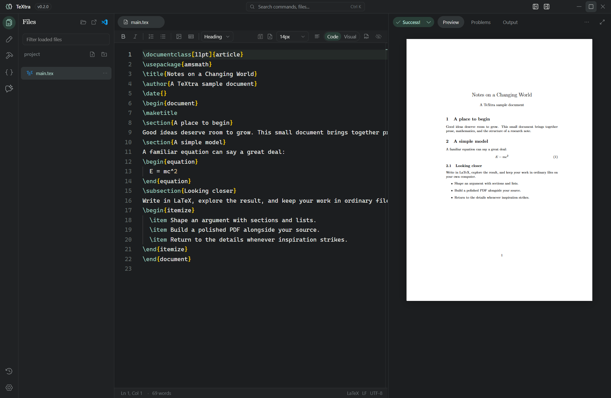
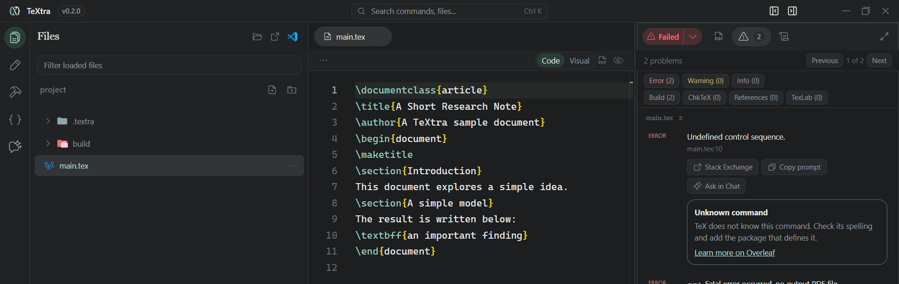
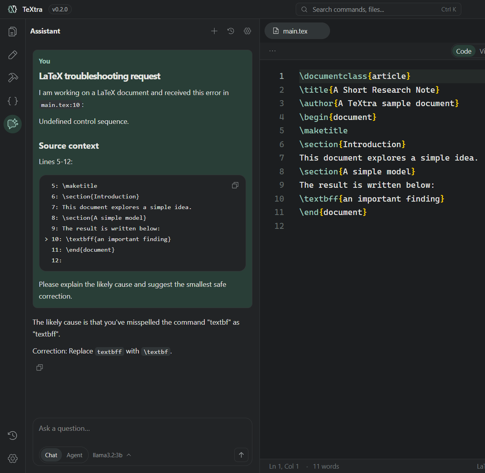

# TeXtra

**A local-first home for writing in LaTeX.**

TeXtra brings your source, writing tools, and compiled PDF together in a desktop
workspace. Open a folder, work with your own `.tex` files, and turn them into a
finished document with your local TeX installation. No account is required for
editing or local compilation.



## From first draft to finished PDF

- **Write your way.** Edit LaTeX directly with completion, diagnostics, navigation,
  and syntax-aware tools, or switch to Visual mode for a prose-focused view of
  headings, lists, equations, and more. Both views work on the same document.
- **See the result as you work.** Compile the active document and read its PDF next
  to your source. Search and zoom the preview, and use SyncTeX to navigate between
  the PDF and source when the required tools are installed.
- **Keep a project in view.** Browse files, jump through a document outline, and
  follow the files referenced by your document. Tabs keep multiple files close at
  hand, while snippets and symbols help with common LaTeX constructs.
- **Make the workspace yours.** Choose a theme, adjust the layout, and configure
  build recipes for your documents. The command palette puts common actions within
  reach.

Visual mode supports common LaTeX structures; more unusual or incomplete source
may appear in editable source-backed blocks or be easier to work with in Code mode.
The PDF remains the typeset result.

## Work with confidence

Your projects are ordinary files in folders you choose. TeXtra saves locally,
keeps project-local file history, and detects external changes so you can review a
conflict or save a separate copy of your work. It also supports collaboration through
a shared project folder. Some collaboration and cross-platform cases are still
being verified.

## AI assistance, your way

Ask questions about LaTeX, get help with errors, and request edits for review
without leaving your workspace. Bring your own API key for providers including
Google, OpenAI, Anthropic, Mistral, DeepSeek, OpenRouter, and Ollama Cloud, or
connect a local Ollama server to enjoy tailored AI chat entirely offline with a
local model. You can also connect a custom OpenAI-compatible endpoint. Choose
models for chat and opt-in autocomplete independently, including Codestral through
Mistral and supported local coding models. When a build reports a problem,
**Ask in Chat** brings the error and nearby source directly into the conversation for
rapid review, and Agent will implement the fix in seconds.
TeXtra is completely free: Any Cloud API usage is billed through your provider account.





## Try TeXtra

TeXtra is under active development. Releases will be available on the
[GitHub releases page](https://github.com/aarondwolf/textra/releases). To run
from source, install **Node.js 24 LTS** and **npm 11**, then run:

```sh
npm ci
npm run dev
```

Open a project folder and select a `.tex` file to start writing. To compile, install
a TeX distribution such as MiKTeX or TeX Live separately, then choose **Compile**.
A Windows x64 installer is planned for release; installation and release checks
are still in progress. Windows has received the most native testing so far, while
macOS and Linux verification remains open.
