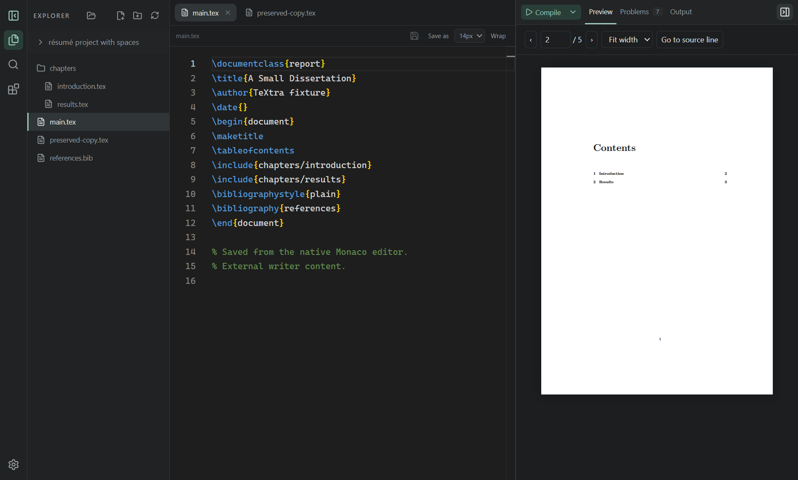

# TeXtra

A modern, local-first LaTeX desktop IDE. Your documents stay ordinary files on
your computer. Editing and local compilation never require an account; AI is
optional. The AI assistant works with your own Google, OpenAI, Anthropic, Mistral, DeepSeek, OpenRouter or Ollama Cloud key, or
with a local Ollama server.



## Current status

- [x] Phase 0: native Electron shell, themes, pane controls, command palette
- [x] Core IDE: real folders, Monaco tabs, safe saves, local builds, PDF.js, SyncTeX
- [x] Recent/pinned projects, file CRUD, portable settings, project build preferences
- [x] Editable ordered build recipes, project settings JSON and recipe builder
- [x] Phase 1 workflow: collapsible explorer, reveal-active, persisted editor settings, custom TeX paths, PDF match highlights
- [x] TexLab 5.26.0: bundled Windows language intelligence and editor navigation
- [ ] Phase 1 verification: XeLaTeX/LuaLaTeX, macOS/Linux, crop/rotation SyncTeX
- [x] Phase 2 workflows: writing tools, diagnostics, optional AI
- [ ] Phase 2 verification: complete native/platform interaction matrix
- [ ] Phase 3: research and presentation workflows
- [ ] Phase 4: installers, TeX installation help and distribution

## Development

Prerequisites: Node 24 LTS, npm 11; optional MiKTeX/TeX Live/MacTeX for compilation.
Git is recommended. No API key is needed. Open this repository and run:

```powershell
npm install
npm run dev
```

Validation: `npm run typecheck`, `npm run lint`, `npm run format:check`, `npm test`,
`npm run build`, `npm run test:e2e`. Installer packaging is not configured yet.
The primary iteration loop is a native Electron window with React HMR.
Startup restores the active saved document first, then the remaining tabs and file
tree. The editor, PDF preview and optional panels load separately. When available,
the last validated PDF is labelled **Last compiled**; compilation still requires
your action. AI background preparation only reads local settings and imports code,
prioritizing selected defaults without contacting a provider or warming a model.
See [startup measurements](docs/PERFORMANCE.md) for reproducible checks and limits.
`npm run test:dev` verifies HMR and main/preload reload behavior; run it without
concurrent source edits because it temporarily appends and restores test probes.
See the [Electron audit and refactor](docs/ELECTRON_AUDIT.md) for the current
resource, document-preservation and history-storage architecture.

## Workflow and setup

Use Ctrl/Cmd+K for commands, Ctrl/Cmd+B for the sidebar, Ctrl/Cmd+J to switch between
the preview and its Output tab, and drag the split or use arrow keys on it. Collapse
either side pane with its small collapse icon. Settings lives at the bottom of the
left rail, including the theme selector. Themes and layouts are saved
to `preferences.json` in Electron userData (`%APPDATA%/TeXtra` on Windows).
The rail has two sidebar views. Files is the plain project tree. Document shows the open
`.tex` file's section outline (included chapters spliced in place) and a tree of the files
it uses (`\input`, `\include`, `\subfile`, bibliographies, graphics, local style files),
not the directory contents. Missing references are flagged. Click a heading or file to jump.
Recent Projects is a collapsible section at the bottom of the explorer, closed by default.

1. Choose **Open folder**, then select a `.tex` file in the explorer. Multiple tabs
   preserve editor models and undo while open. Use Ctrl/Cmd+S to save, Shift+Ctrl/Cmd+S
   to save a copy, and Monaco's Ctrl/Cmd+F or Ctrl/Cmd+H for search/replace.
   Left-click an explorer entry for Rename, Delete, Reveal, and VS Code actions;
   files open in the editor as well. Right-click and Shift+F10 also open this menu.
2. **Compile** in the preview pane (Ctrl/Cmd+Enter) builds the active `.tex` tab and saves all
   dirty files first. Use its dropdown to choose a recipe. Each document remembers
   its last used recipe; **Settings → Compilation** sets the default for new documents.
   **Compile ▾ → Manage recipes…** edits defaults, creates recipes and opens the
   project JSON editor. See [project settings and recipes](docs/RECIPES.md).
   Presets: direct pdfLaTeX, XeLaTeX, LuaLaTeX, latexmk, and
   pdfLaTeX → BibTeX → pdfLaTeX twice. Cancel stops the process tree.
3. Switch between Preview, Output, and source-linked Problems inside the preview pane.
   Compile, the view tabs, and the collapse control share one compact row.
   Compiling preserves your selected view. Successful PDFs load beside the editor.
   Ctrl/Cmd+F within the preview opens PDF search; Escape closes it. Ctrl/Cmd+H opens
   replacement in the source editor, where edits can be recompiled. Navigate pages,
   zoom/fit width, or use **Go to source line**.
   Double-click the PDF to jump back to source with the installed SyncTeX tool.

External changes are watched as well as revision-polled. On detection, TeXtra locks ordinary
Save, autosave and Ctrl/Cmd+S for that tab, preserves its complete in-memory buffer, and opens a
conflict decision. Save a collision-safe sibling such as
`chapter.CONFLICTED_2026-10-20_143522.tex`, or close TeXtra’s buffer to give the external editor
precedence. After a configurable 2–5 second quiet period, a read-only Monaco diff can compare the
preserved buffer with the external file; it does not merge. Preferences can use polling only for
Dropbox/network folders. Save As never replaces an existing file. Closing/switching checks unsaved
edits. Delete uses the OS trash.

**File history** keeps compressed source snapshots inside `.textra/history`, so history
moves with the project. The History view loads snapshots in pages and supports reviewed
restore, export, pinning and deletion. Restore preserves the current buffer and disk
version before replacing the file; failed backups prevent restoration. Invalid history
catalogs are preserved and reported. Older app-data history can be explicitly recovered
from the History view after selecting the correct store; originals remain untouched.
History is plaintext project data and can be copied by your folder's sync service.

A second launch focuses the running window for that profile. Closing waits for pending
settings and document writes; if a persistence barrier fails, TeXtra stays open.

**TexLab language intelligence** is bundled for Windows x64 and enabled by default. It powers
LaTeX completion, hover, definitions, references, document symbols, folding, inlay hints, and
diagnostics. Disable it in **Settings → LaTeX tools** to use TeXtra's local fallback suggestions.
The bundled release is TexLab 5.26.0; attribution and source details are in
`resources/texlab/THIRD_PARTY_NOTICES.md`.

The gear button opens **Settings**, with a side list of sections: Appearance,
LaTeX tools (detected executables with an edit icon for each path, re-detection, a real
temporary test compile, official installer pages), Compilation, and Import & export. No installers or missing packages run automatically. Windows uses
MiKTeX/TeX Live; macOS can use MacTeX; Linux users should use their distribution's
TeX packages. Restart after PATH changes. If a tool is not on PATH, use the pencil beside it
in Settings to choose the executable. Guided installation moves to Phase 4.

Layout/theme, the default recipe, and recents live in Electron userData. Document
recipe choices and tool definitions live in `.textra/settings.json`, created when
opening a project. Legacy `project.json` is migrated without deletion. Open folders with
the folder icon in the explorer. Import/export accepts only versioned theme/layout/recipe
settings; unknown schemas and corrupt files are preserved. Recent folders, keys and
tool paths are excluded. Offline operation is the default. Settings save automatically; the
footer of Settings and AI settings shows Saving… and All changes saved, and **Save settings**
waits for pending writes before closing. Provider connection drafts use their own Save button.

The **AI Chat** rail tab opens the assistant, one conversation that answers LaTeX questions
and, when you ask for a change, proposes reviewed edits to the open `.tex` file. Until a provider is connected it
shows a single **Configure AI** button that opens the **AI settings** dialog (also reachable
from the chat header **Settings** button and **Settings → AI Chat**). A fresh installation
shows **Add Provider +**. Add a connection, then use its compact row to enable/silence,
Edit or Delete it. Supported connections include Google Gemini, OpenAI, Anthropic,
Mistral, DeepSeek, OpenRouter, Ollama Cloud, Local Ollama and one custom
OpenAI-compatible endpoint. Mistral uses one key for chat and Codestral FIM.

Saving connection details is offline; **Test / Refresh** explicitly contacts the
provider and caches its models. Advanced settings contain its API base URL, manual
model IDs and independent All/Include/Exclude visibility lists for Assistant/Inline
and automatic completion. Each preference can be reset individually. Silencing keeps
the key and model catalogue while preventing requests, SDK initialization and pings.
Custom endpoints use standard Chat Completions; their API key is optional. Turn on tool
support for a custom endpoint to let the assistant read and edit the open file; without it
the assistant answers in text only and says so beside the composer. HTTPS is required except configured local
or private-network HTTP servers, which display an unencrypted-connection notice.

Chat and Agent share the Assistant model. Chat is the default and answers without
reading the active document. Switch to **Agent** when you want it to inspect or edit
the open `.tex` file; pressing Send shares that captured file with the selected model,
which stages edits for review. **Ask in AI** from Problems always opens in Chat mode.
Agent mode skips a separate initial file-read call, but tool calls and the final reply
still require provider round trips. Automatically sent Problems prompts stay tool-free.
Both modes can use the same text model; connections with tool calls disabled remain
available in Chat and cannot enter Agent mode.
User prompts support the same safe Markdown formatting as assistant replies, and a
new send after a failed turn appears as its own message bubble.
Gemini 3.5 Flash-Lite uses minimal thinking in Chat and low thinking in Agent to reduce
latency. Provider HTTP errors show the provider's safe status detail, so service outages
are distinguishable from local connection failures.

Assistant and Inline Edit (Ctrl+I) share one compact default-model card. Automatic
completion has a separate opt-in card and reveals its selector only while enabled.
Assistant and Ctrl+I also support independent temporary workspace selections that
reset after restart. Hidden, missing or silenced models remain displayed as unavailable;
requests are blocked until you choose or restore a model. Deleting a provider clears
its bindings. Changing an endpoint revokes automatic-sharing consent.
The composer's model button opens a searchable list grouped by provider (type to filter by
model name, id or provider; arrows and Enter choose). The Assistant lists text chat
models; automatic completion also lists native fill-in-the-middle (FIM) models. Capability metadata is used where available, with model-family filtering
for providers that omit it. Vision input models that produce text remain available;
image/audio generation, embeddings and other specialist endpoints are excluded.
Refresh models updates capability checks. Changing one role never changes another. Requests
use the Vercel AI SDK's native adapter for each provider (OpenAI through Chat Completions,
Google, Anthropic, Mistral, DeepSeek and OpenRouter), and its OpenAI-compatible adapter for
Ollama and custom endpoints. Everything runs in TeXtra's main process with your own keys:
there is no hosted gateway, no account, and no automatic retry.
OpenRouter lists text models from its authenticated account catalogue, respecting
your account's provider/privacy preferences. It routes submitted text to the
selected model's hosting provider. TeXtra disables automatic provider fallback and
requires routed providers to support every request parameter, including tools. Dynamic auto/free router
entries are excluded so you choose an explicit model.
**New chat** clears prior conversation context and retries while preserving unsent draft text.
Settings can enable automatic
Problems prompts (off by default). **Ask in Chat** prepares the selected error plus five
source lines above and below for review. Sending shares that conversation/snippet with
the selected model's provider (local-only Ollama models stay on the computer; Ollama cloud models use Ollama Cloud).
The open `.tex` file appears beside the composer as available context. Chat never sends it;
Agent sends the captured buffer only after you select Agent and press **Send**. Agent can stage
precise insertions/replacements in that file. Automatically sent Problems prompts never get
document access and **Ask in AI** defaults to Chat. With no `.tex` file open, the assistant simply
answers. It cannot browse other files, delete files, or run commands. Every proposed edit opens
an inline read-only diff in the editor. **Approve** immediately applies that change to the
buffer and advances to the next; **Reject** skips that change. The final decision returns
to the normal editor. **Approve all** applies the remaining changes together; **Reject all**
discards the remaining proposal and preserves changes already approved. Each approval is undoable.
Auto-save pauses during review and resumes for approved text when review finishes.
Changing the file, its content, or its disk revision expires the proposal. A request has a
24-response/64-tool budget with a 90-second deadline (180 seconds for Local Ollama); a
proposal appears only when the whole request finishes. While it works, the assistant shows short
status lines such as "Reading the active document". Reviewed replies are labelled _Changes
applied_, _Some changes applied_ or _Changes rejected_, and the assistant is told the same, so
a rejected proposal is never treated as applied. To act on advice from an earlier reply, just
ask (for example "apply that fix"); the proposal still needs your review.
**Chat history** restores workspace-specific conversations, including after restarting TeXtra.
Only conversation text and review labels are stored; tool transcripts are not.
History keeps the latest 100 chats per canonical workspace in local app data (`ai-chats/`),
with at most 80 messages/128,000 characters per stored transcript. History contains plaintext
conversation text, never API credentials or pending edits; it is excluded from settings exports.
Unsent drafts remain in memory. **Ctrl+Enter** sends; Enter inserts a newline. Cancel stops waiting
locally; a provider may still process a request already sent.
Responses stream as full-width Markdown with a copy action below; fenced code in either your
messages or assistant replies has an always-visible copy button. When a model provides separate
reasoning text, TeXtra shows it in a faded panel that starts collapsed and is not saved with chat
history. Only your messages use bubbles. The compact composer has two text rows, no resize handle, a model menu, and a circular
send arrow (a stop control during streaming). The introductory
guidance disappears once a conversation starts. The chat tab sits with the main rail views.

**Ctrl+I inline editing** opens a focused instruction box inside an editable TeX buffer.
Type what to insert or change; Enter generates, Shift+Enter adds a prompt line, and
Escape cancels. Opening the box sends nothing. With a selection, review a replacement
as an inline diff; otherwise review an insertion as ghost text. The preview grows while the
model streams, and Accept becomes available once generation finishes. Accept applies one
undoable edit; insertion ghost text also accepts with Tab. The panel has its own
model picker, Generate/Regenerate and Cancel controls. Changing models clears the
preview without submitting again. Ordinary TexLab completion, Ctrl+Space, snippets
and indentation retain their normal behavior when no AI insertion can be accepted.
TexLab suggestions are limited to LaTeX commands and structured arguments; generic
word suggestions are disabled so ordinary prose does not open a completion popup.

Automatic suggestions start **off**. Enable them in AI settings after choosing a model
and confirming its destination and bounded context sharing. Changing that model while
enabled asks again. By default they run inside non-document environments and math,
including custom environments, proofs and literal code blocks. Comments, comment
environments and inline \verb are excluded. **Allow suggestions outside environments**
separately permits prose and preamble continuation. Declared minted/lstlisting languages
are preserved; unknown languages and verbatim receive literal-text continuation.

Automatic completion displays **ghost text only**: Tab accepts the entire suggestion
as one undoable edit and Escape dismisses it. Health/errors and Retry are in AI settings.
Automatic context is bounded to 8,000 prefix / 2,000 suffix / 2,000 metadata characters;
local-only Ollama uses smaller 1,024/256 prefix/suffix context. Suggestions target
1–10 lines/384 tokens after a 750 ms pause, at most one start every two seconds,
with a 10-second remote or 30-second local deadline.

Prompted Ctrl+I sends up to 4,000 instruction characters, 16,000 selected characters,
16,000 prefix / 4,000 suffix / 4,000 metadata characters. It allows 4,096 output tokens,
32,000 output characters and 60 seconds. Both modes use only the active buffer,
without conversation history or other project files. Typing, navigation, model changes,
conflicts and assistant review invalidate pending proposals. Suggestions never apply themselves.

Local Qwen coder models with verified FIM templates use Ollama's native generate API;
new automatic bindings prefer an already installed Qwen2.5-Coder 0.5B model.
Codestral automatic completion uses native FIM through the Mistral connection; prompted edits use chat.
Other text models use the same completion instructions through the AI SDK's streaming text route.
There is no fallback or automatic retry. Ollama is kept warm for five minutes after real
completion requests; opening TeXtra does not start or warm it. Automatic failures stay
quiet and authentication/quota errors pause suggestions until retry or configuration change.

MVP AI settings live in git-ignored `.textra-local/ai.json` inside this application checkout,
with each key encrypted by Electron `safeStorage` for your OS account. No plaintext fallback
is allowed. Do not distribute this local directory or put it under source control. Before
public release, migrate it to global app data; see [security](docs/SECURITY.md).
Provider pricing, free tiers and limits depend on your account; TeXtra adds no fee.
Quota notices suggest switching models or trying again later, with a link to that
provider's usage page.

Recipes default to `build/textra/<relative document>/` and retain the last successful
PDF through failures. Custom output folders are never automatically pruned. The
temporary installation health check uses an isolated folder.

## Architecture and contribution

`src/main` owns files/processes; `src/preload` is the narrow typed bridge;
`src/renderer` contains the UI; `src/shared` defines contracts; `tests` contains
fixtures and verification. Read [AGENTS.md](AGENTS.md) before contributing.
Run all checks before a change is considered complete.

## Troubleshooting

- Missing TeX: check `pdflatex --version` and restart after changing PATH.
- Failed build: inspect the full Output panel; missing packages may need your distribution manager.
- SyncTeX: requires the executable and output produced with `-synctex=1`.
- PDF preview: a failed compile may leave no new PDF; use the last successful build.
- Conflict: Save As preserves your buffer; Reload from disk requires confirmation.
- Invalid project settings: preserve and inspect `.textra/project.json`; move it
  aside manually before recreating settings. Do not delete it blindly.
- Development startup: install dependencies and run typecheck/build for actionable errors.
- Dropbox/OneDrive: the development dependency cache lives in OS temp to avoid
  sync locks. If output cleanup reports EBUSY, close the running app before rebuilding.

Source content stays local. TeX input is powerful: compile trusted projects only.
See the [security](docs/SECURITY.md), [architecture](docs/ARCHITECTURE.md),
[testing](docs/TESTING.md), and [unfinished work](docs/ROADMAP.md) guides.

License: **pending owner decision; no open-source license granted yet.**
