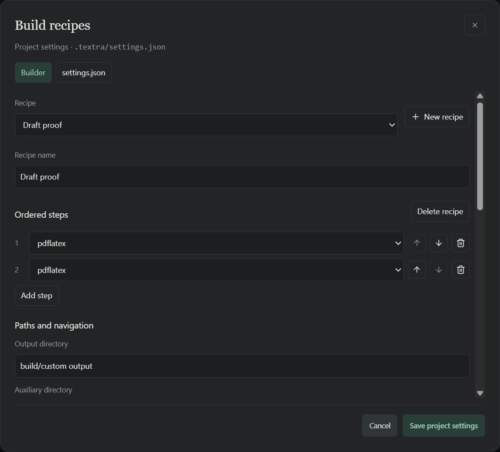

# Project settings and build recipes

Opening a project creates `.textra/settings.json` with editable defaults. Existing
`.textra/project.json` settings are migrated when no canonical settings file exists;
the original file is preserved. Comments and trailing commas are accepted.

Use **Compile ▾ → Manage recipes…**, or **Settings → Compilation → Edit project build recipes**.

The dialog opens on a plain list of recipes, each with a pencil icon that opens the
guided editor. The same screen has the **Output location** choice, the project default
recipe, and a link to edit `settings.json` directly. All three views save the same
project file. You can also edit it externally; Compile reads it afresh each time. A popup
cannot overwrite settings changed externally since it opened: cancel and reopen it
to reload. Saving through the popup formats the JSON and removes comments.

### Output location

Three choices, all stored as `outDir` and `auxDir`:

- **Everything in the build folder** (default): `build/textra/%RELATIVE_DOC%` with
  auxiliary files beside the PDF (`%OUTDIR%`).
- **PDF next to the .tex file, other files in the build folder**: `outDir` is `%DIR%` and
  `auxDir` is the build folder. This needs the MiKTeX engines (pdflatex, xelatex,
  lualatex); latexmk and TeX Live builds report a clear error and should use the default.
- **Custom paths**: type both directories, with clickable `%TAG%` buttons.

"Separate folder for each document" appends `%RELATIVE_DOC%` so identically named files in
different folders never collide. A collapsible "What do the %TAGS% mean?" list explains
every placeholder.

### Recipes and tools are edited separately

The first screen lists **Recipes** and **Tools**, each with its own pencil. A recipe is an
ordered list of steps; a tool is one program with its options. Each step has a pencil that
jumps to its tool. Tool editing covers the name, program, option chips, duplicate and
delete (a tool still used by a recipe cannot be deleted).

To make early passes faster, open a recipe and press **Use draft mode for early passes**.
Every compiler pass except the last switches to a `-draft` copy of its tool that adds
`-draftmode`. Draft passes skip writing the PDF but still write `.aux`, `.toc` and similar
files, so references and citations resolve; only the final pass writes the PDF.

### Guided recipe editor

Steps are listed in order with reorder and remove buttons, and an "Add step" menu that
can also create a new tool from a supported program. Each tool's editor has an
options card. Options appear as toggle chips (SyncTeX, keep going on errors, file and line
errors, stop at first error, latexmk engine mode and so on); hovering or focusing a chip
explains the argument it adds. The output-folder argument and the document input are shown
as locked chips because TeXtra manages them. Extra arguments can be typed in, and a text
view shows every argument. A tool shared by several recipes says so.



## Format

Recipes and tools use the same keys and object structure as
[LaTeX Workshop](https://github.com/James-Yu/LaTeX-Workshop/wiki/Compile#latex-recipes):
named recipes reference an ordered list of named tools, each with a command and
an argument array. Copy the supported recipe settings from VS Code, rather than
the entire VS Code settings file.

```json
{
  "latex-workshop.latex.recipes": [{ "name": "pdfLaTeX twice", "tools": ["pdflatex", "pdflatex"] }],
  "latex-workshop.latex.tools": [
    {
      "name": "pdflatex",
      "command": "pdflatex",
      "args": [
        "-synctex=1",
        "-interaction=nonstopmode",
        "-file-line-error",
        "-halt-on-error",
        "-output-directory=%OUTDIR%",
        "%DOC_EXT%"
      ],
      "cwd": "%DIR%"
    }
  ],
  "latex-workshop.latex.outDir": "build/textra/%RELATIVE_DOC%",
  "latex-workshop.latex.auxDir": "%OUTDIR%",
  "latex-workshop.latex.recipe.default": "lastUsed"
}
```

The editor can rename or create recipes, reorder/add/remove steps, edit tools and
arguments, choose the output location and set the project default. Editing a shared tool affects every recipe that references it. The `env`
object is editable in the JSON view.

`first`, `lastUsed`, or a recipe name can be the default. Documents remember their
selected recipe in the project's `recipes` map; documents without a saved choice
use the project default, falling back to the app default when `lastUsed` is selected.
Compile always targets the active `.tex` tab.

## Paths and supported options

Supported placeholders are `%DOC%` (absolute document path without extension),
`%DOC_EXT%`, `%DOCFILE%`, `%DOCFILE_EXT%`, `%DIR%`, `%WORKSPACE_FOLDER%`,
`%RELATIVE_DIR%`, `%RELATIVE_DOC%`, `%OUTDIR%` and `%AUXDIR%`, including `_W32`
variants. Output paths without a placeholder are relative to the project folder;
`cwd` defaults to the source directory for TeX tools and auxiliary directory for
bibliography tools. Paths with spaces stay single arguments; do not add shell quotes.

Output defaults to a distinct directory per relative document path, avoiding
collisions between identically named files in different folders. `%DIR%` places
the PDF beside the source. Separate auxiliary directories currently require a direct
MiKTeX engine; latexmk and TeX Live builds must use `%OUTDIR%` for auxiliaries.
Tool output/auxiliary flags must agree with the configured directories.

Supported commands are `pdflatex`, `xelatex`, `lualatex`, `latexmk`, `bibtex` and
`biber`, with optional `.exe` suffix. Executables are discovered on PATH. Common
compiler options, SyncTeX, simple job names, and latexmk PDF/XeLaTeX/LuaLaTeX modes
are supported. Unsupported placeholders, commands and flags produce explicit errors.
Scripts, arbitrary executable paths, shell escape and latexmk command/config
overrides are rejected. The command/argument separation is compatible with
LaTeX Workshop; TeXtra intentionally supports a narrower execution surface.

All directories stay inside the selected project, without links or protected
metadata paths. Search-path environment overrides support `TEXINPUTS`, `BIBINPUTS`,
`BSTINPUTS` and `TEXMFHOME` with project-contained directories; PATH overrides and
other environment keys are rejected. Processes use no shell, keep existing timeout
and cancellation limits, and disable shell escape and automatic package installation.

Configured output folders are never pruned automatically. Failed builds keep the
last successful PDF in memory; SyncTeX is unavailable for a cached PDF if a failed
build may have changed its sidecar. Same-path successful recompiles reload the PDF
while preserving the viewer position.
